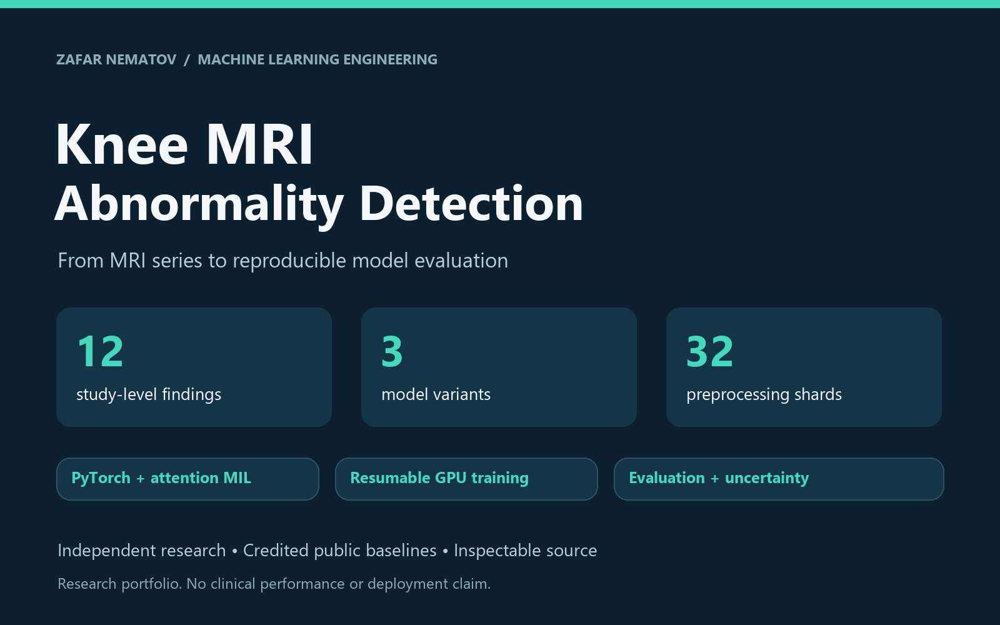
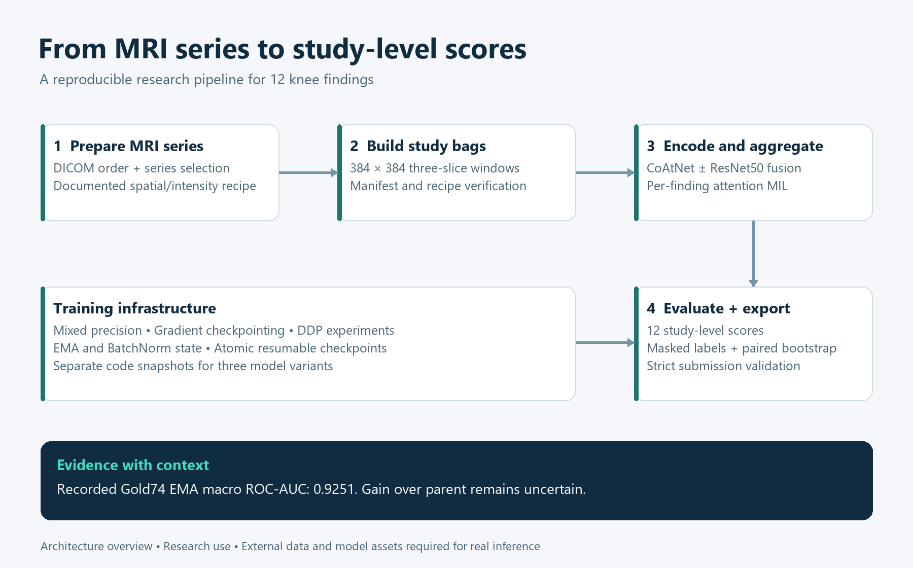
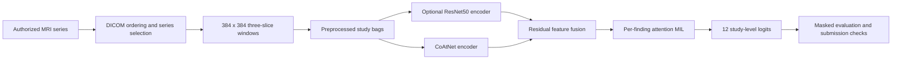
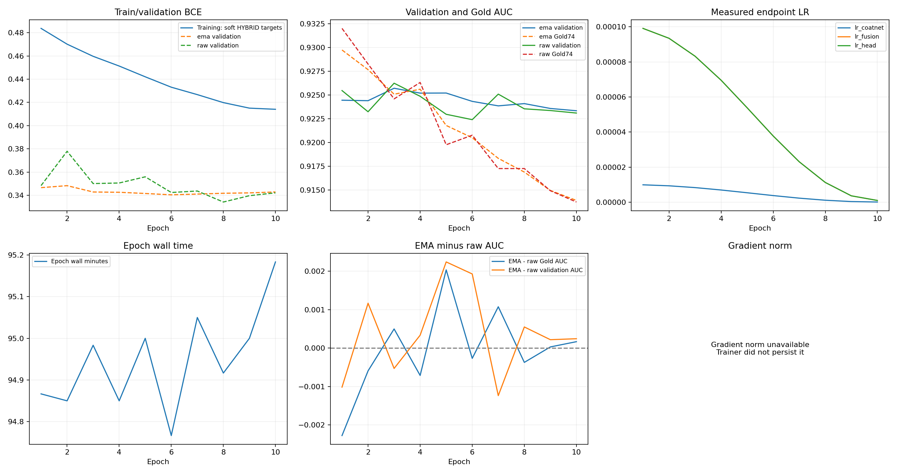

# RSNA Knee MRI Abnormality Detection

**An end-to-end computer vision research portfolio by Zafar Nematov:** MRI preprocessing, attention-based multiple-instance learning, distributed training, reproducible inference, and statistical model evaluation.



[Case study](docs/PORTFOLIO_CASE_STUDY.md) · [Architecture](docs/ARCHITECTURE.md) · [Setup & reproduction](docs/REPRODUCIBILITY.md) · [Model card](docs/MODEL_CARD.md) · [Upwork portfolio copy](docs/UPWORK_PORTFOLIO.md)

## What this project demonstrates

This project turns variable-length knee MRI studies into study-level predictions for **12 abnormalities**. It combines a documented reproduction of a public Kaggle baseline with custom data pipelines, CoAtNet/ResNet fusion experiments, training infrastructure, and an evaluation audit.

The engineering work covers series-aware DICOM sampling, 384 × 384 slice triplets, preprocessing across 32 shards, attention pooling over study bags, mixed precision, gradient checkpointing, DDP, EMA, resumable training, five-fold workflows, and strict submission validation. The repository includes the current code from three research worktrees, including previously uncommitted training and inference tools.

This is a research and engineering portfolio. The models have not been validated for clinical use.

## Start here

| If you want to… | Read or inspect |
| --- | --- |
| Understand the problem and the delivered work | [Portfolio case study](docs/PORTFOLIO_CASE_STUDY.md) |
| Review the strongest engineering examples | [Reviewer guide](docs/REPOSITORY_GUIDE.md) |
| Inspect the latest ResNet fusion experiment | [ResNet50 variant](experiments/resnet50_fusion/README.md) |
| Inspect the simpler CoAtNet model | [CoAtNet-only variant](experiments/coatnet_only/README.md) |
| Run a data-free demonstration | `python scripts/portfolio_demo.py` |
| Reproduce an experiment with authorized assets | [Reproducibility guide](docs/REPRODUCIBILITY.md) |

## Pipeline





The preprocessing recipes are distinct experiments. The six-slot recipe retains its documented boundary windows; the series-safe and minimum-overlap recipes enforce their own within-series construction rules. See the [architecture guide](docs/ARCHITECTURE.md) before choosing a dataset/model combination.

## Recorded results, with context

The table below summarizes the existing **Gold74** evaluation report. Each result is macro ROC-AUC across available labels on 74 studies, with missing labels masked. These are recorded research results, not a new training run performed for this portfolio.

| Evaluated checkpoint | Macro ROC-AUC | Study-bootstrap 95% interval |
| --- | ---: | ---: |
| Original parent, same evaluation pipeline | 0.922612 | 0.900635–0.942124 |
| Validation-selected ResNet fusion, raw epoch 3 | 0.924824 | 0.900362–0.944714 |
| Validation-selected ResNet fusion, EMA epoch 3 | 0.925106 | 0.900750–0.946106 |
| Historical five-model comparison ensemble | 0.924730 | 0.900259–0.945342 |

**The fusion improvement is uncertain:** the paired EMA-minus-parent difference is +0.002494, with a 95% interval of −0.009237 to +0.012958. Fusion ablations also cross zero. The parent may already have seen studies used in later training/validation splits, patient-level separation is unproven, and historical Gold inspection limits independence. The audit reports these limitations rather than claiming an established architecture gain.

The public baseline's historical **0.943 leaderboard anchor belongs to the credited upstream work**. It is not a score earned by the custom fusion model or a claim of competition placement.

Evidence: [full statistical report](results/resnet50_20261013/REPORT.md), [headline metrics](results/resnet50_20261013/headline_metrics.csv), [paired comparisons](results/resnet50_20261013/paired_macro_auc_deltas.csv), and [evaluation protocol](docs/MODEL_CARD.md).



## Repository layout

```text
models/                         Original RadImageNet fusion architecture
raptor_data/                    Study datasets, sampling, and fold helpers
scripts/                       Preprocessing, training, inference, and audits
tests/                         Root experiment regression tests
kaggle/                        Baseline and generated execution notebooks
configs/                       Recorded experiment configurations
experiments/resnet50_fusion/    Self-contained gated ImageNet ResNet50 variant
experiments/coatnet_only/       Self-contained CoAtNet-only variant
docs/                          Technical guides and portfolio materials
assets/                        Portfolio cover and architecture diagram
results/                       Selected aggregate reports and plots
manifests/                     Dependency audit and source snapshot hashes
```

Each variant has its own `models`, `scripts`, and `tests` directories. Run it from its own directory to avoid importing another variant with the same package name.

## Quick start

Use Python 3.12 and a compatible PyTorch/torchvision pair. CPU is sufficient for the synthetic demo and the lightweight regression checks. Real training requires authorized data, pretrained checkpoints, and a CUDA GPU.

```bash
git clone https://github.com/zITnEt/RSNA-Knee-Abnormality-Detection.git
cd RSNA-Knee-Abnormality-Detection
python -m venv .venv
# Windows PowerShell: .venv\Scripts\Activate.ps1
# Linux/macOS: source .venv/bin/activate
python -m pip install -r requirements.txt
python scripts/portfolio_demo.py
python scripts/run_portfolio_checks.py
```

The demo uses generated scores and labels to exercise the submission validator. It does not load a medical model or produce medical predictions. [Setup instructions](docs/REPRODUCIBILITY.md) explain the assets required for real inference and training.

## Data, attribution, and publication scope

Raw MRI images, reports, label tables, preprocessed tensors, model weights, credentials, cloud runtime state, and per-study evaluation exports are excluded from this publication snapshot. Obtain external assets from their original sources under the applicable terms; see the [data card](docs/DATA_CARD.md). Historical Git branches retain their original research organization.

The public baseline, pretrained models, and adapted architecture components are credited in [THIRD_PARTY_NOTICES.md](THIRD_PARTY_NOTICES.md). This repository does not claim original authorship of those works or grant new rights to their data and weights. [LICENSE.md](LICENSE.md) describes the publication's rights status.

For contribution guidance, see [CONTRIBUTING.md](CONTRIBUTING.md). For citation metadata, see [CITATION.cff](CITATION.cff).
